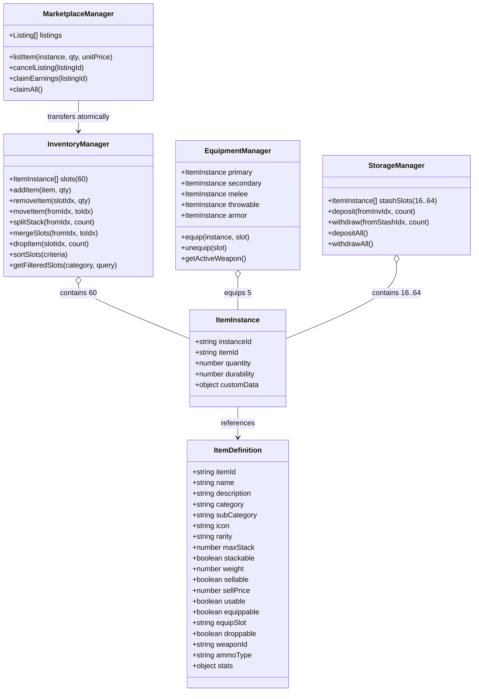

# INVENTORY_SYSTEM_AUDIT.md — DEAD ZONE
## Audit Komprehensif Sistem Inventaris, Senjata, Perlengkapan, dan Penyimpanan Pemain

**Tanggal Audit:** 11 November 2026  
**Target Proyek:** Dead Zone (3D FPS Zombie Survival & Rural Economy Engine)  
**Tujuan:** Menganalisis kelemahan arsitektur, inkonsistensi data, dan bug teknis pada sistem inventaris lama sebelum melakukan rekonstruksi total (Complete Rebuild).

---

### 1. KONDISI SISTEM LAMA

Sistem lama pada Dead Zone berkembang secara organik melalui beberapa iterasi pembaruan:
- **Sistem Ransel Klasik (`backpack`):** Array flat berisi objek item dengan batas kapasitas 6 slot (`backpackMaxSlots = 6`). Setiap item menempati 1 indeks array tanpa pemisahan tegas antara kuantitas dan identitas instans.
- **Sistem Inventaris 60-Slot Tambahan (`inventory`):** Array berindeks `[0..59]` yang menyimpan objek `{ slotIndex, item, count }`. Sistem ini beroperasi secara paralel di samping `backpack`.
- **Sistem Peti Penyimpanan (`stash`):** Array flat terpisah (16-64 slot) di Safehouse tanpa skema slot terindeks.
- **Sistem Kantong Aman (`securePouch`):** Array flat 2 slot kebal hangus saat mati di Sector-7.
- **Sistem Etalase Kios (`playerShopStall`):** Array 4 slot etalase dengan margin keuntungan +25%.
- **Sistem Marketplace (`marketplaceListings`):** Array data listing dengan simulasi waktu penjualan.
- **Sistem Senjata (`weapons.js`):** Senjata dikelola secara terpisah melalui array string `ownedWeapons` di `GameState` dan objek runtime `weaponData` di `WeaponManager`.

---

### 2. MASALAH DAN INKONSISTENSI YANG DITEMUKAN

Berdasarkan audit mendalam terhadap basis kode, ditemukan masalah-masalah struktural berikut:

1. **Fragmentasi Data Multi-Container (Bukan Single Source of Truth):**
   - Pemain memiliki 6 kontainer penyimpanan berbeda yang tidak terhubung secara atomik: `backpack`, `inventory`, `stash`, `securePouch`, `playerShopStall`, dan `marketplaceListings`.
   - Ketika item masuk ke `backpack`, fungsi `addItemToBackpack` mencoba melakukan sinkronisasi dengan memanggil `addItemToInventory`. Namun, saat item dikeluarkan, dijual, atau hangus saat kematian (`clearBackpackOnDeath`), item di `inventory` **tidak dihapus**! Akibatnya timbul "item hantu" (phantom duplicate items).
2. **Ketiadaan Konsep Item Instance & Item Definition:**
   - Tidak ada pemisahan antara definisi dasar (`ItemDefinition`) dengan kepemilikan unik (`ItemInstance`).
   - Senjata diperlakukan sebagai string nama `'pulse_pistol'` atau objek generik tanpa data instans unik (seperti jumlah peluru dalam magasin, status durabilitas, atau `instanceId` unik).
3. **Ketiadaan Sistem Equipment (Slot Perlengkapan):**
   - Tidak ada slot equipment formal (`Primary Weapon`, `Secondary Weapon`, `Melee Weapon`, `Throwable/Utility`, `Armor/Body`).
   - Senjata diakses langsung dari daftar kepemilikan global `ownedWeapons`, dan tombol angka `1` sampai `7` di-hardcode ke indeks jenis senjata tertentu bukan ke slot perlengkapan pemain.
4. **Ketiadaan Mekanik Manipulasi Slot (Move, Split, Merge, Drop ke Dunia):**
   - Pemain tidak dapat membagi tumpukan (*Split Stack*), misalnya membagi 20 perban menjadi 15 dan 5.
   - Tidak ada mekanisme memindahkan item antar-slot atau menukar (*Swap*) posisi slot di antarmuka inventaris.
   - Aksi "Buang" (*Drop*) hanya memotong data dari inventaris tanpa memunculkan objek 3D fisik yang dapat diambil kembali di dunia game (*World Loot Drop*).
5. **Kebocoran Input Gameplay Saat Antarmuka Terbuka (Input Leakage):**
   - Ketika modal inventaris atau marketplace terbuka, keyboard listener di `Player.onKeyDown` tetap aktif memproses tombol `KeyW`, `KeyA`, `KeyS`, `KeyD`, dan `Space`.
   - Jika pemain mengetik di kolom pencarian inventaris (`#inv-search-input`) menggunakan huruf W, A, S, atau D, karakter 3D di dunia game akan tetap bergerak dan melompat!
6. **Masalah Pointer Lock dan Transisi Kursor Mouse:**
   - Pointer lock dilepas saat modal dibuka, namun klik mouse pada tombol antarmuka dapat secara tidak sengaja memicu tembakan atau kegagalan fokus input jika status mouse tidak disinkronkan dengan state machine menu.
7. **Ketiadaan Fitur Partial Pickup pada World Loot:**
   - Di `loot.js`, pengambilan jarahan hanya memeriksa kondisi biner (`backpack.length < backpackMaxSlots`).
   - Jika pemain hanya memiliki ruang untuk 5 unit dari 15 unit material di dunia, pengambilan barang gagal total atau seluruh barang hilang tanpa menyisakan sisa barang di tanah.
8. **Inkonsistensi Amunisi Magasin vs Cadangan (Reserve Ammo):**
   - Amunisi disimpan di `WeaponManager.weaponData`, sementara kotak amunisi fisik juga disimpan di inventaris (`ammo_pistol`, `ammo_rifle`, `ammo_shotgun`). Penggunaan amunisi cadangan tidak tersinkronisasi otomatis dengan tumpukan amunisi di inventaris.

---

### 3. PENYEBAB TEKNIS SETIAP BUG

| ID Masalah | Gejala Bug | Penyebab Teknis Utama |
|---|---|---|
| **BUG-01** | Item terduplikasi setelah transaksi/kematian | `addItemToBackpack` menyalin item ke `inventory`, namun `removeItemFromBackpack`, `sellItemFromBackpack`, dan `clearBackpackOnDeath` tidak memutasi `inventory`. |
| **BUG-02** | Karakter berjalan saat mengetik di kolom pencarian | `player.js` memeriksa `this.isInputEnabled` secara global, tetapi tidak menonaktifkannya saat elemen `<input>` menerima fokus (`focusin`). |
| **BUG-03** | Senjata tidak memiliki data magasin mandiri | Senjata disimpan sebagai metadata statis tanpa objek `ItemInstance` yang menyimpan `customData: { ammoInMag, durability }`. |
| **BUG-04** | Drop item menghilangkan barang selamanya | `removeItemFromInventory` menghapus item dari memori tanpa memanggil `lootManager.spawnSpecificDrop()`. |
| **BUG-05** | Hotbar tidak fleksibel | Tombol `1`–`7` di `player.selectSlot()` di-bind langsung ke ID statis (`pulse_pistol`, `scatter_blaster`, dll.) bukan ke slot equipment dinamis. |
| **BUG-06** | Tidak bisa membagi atau menggabungkan stack | Belum ada metode `splitStack()` dan `mergeSlot()` pada container logic `GameState`. |
| **BUG-07** | Double event binding pada DOM | Event listener di `shops.js` dipasang langsung pada elemen dinamis yang di-render ulang melalui `innerHTML`, atau dipasang berulang kali tanpa unbind. |

---

### 4. FILE YANG TERLIBAT

1. `gamedevs/dead-zone/js/gameState.js`: Basis data state terpusat, definisi item, metode inventaris, dompet, dan persistensi LocalStorage.
2. `gamedevs/dead-zone/js/weapons.js`: Sistem penembakan, reload, switching senjata, magasin, dan peluru cadangan.
3. `gamedevs/dead-zone/js/player.js`: FPS controller, pendengar input keyboard, mouse look, pointer lock, dan stamina.
4. `gamedevs/dead-zone/js/shops.js`: Pengendali UI untuk seluruh modal (Toko, Lapak FBX, Inventaris, Marketplace, Profil).
5. `gamedevs/dead-zone/js/loot.js`: Spawning objek jarahan 3D di dunia, animasi rotasi, dan deteksi jarak pickup.
6. `gamedevs/dead-zone/js/main.js`: Game loop orchestrator, inisialisasi subsistem, dan callback transisi state.
7. `gamedevs/dead-zone/index.html`: Struktur DOM untuk modal inventaris, equipment, hotbar, dan marketplace.
8. `gamedevs/dead-zone/css/style.css`: Aturan tata letak CSS 3 panel, slot grid 60, status kelangkaan, dan visual equipment.

---

### 5. EVALUASI MODUL (LAYAK DIPERTAHANKAN VS DIPERBAIKI VS DIREMAKE)

#### A. Modul yang Masih Layak Dipertahankan (Preserved):
- **Web Audio API Sound Engine (`audio.js`):** Sintesis suara prosedural (tembakan, langkah kaki, koin, tegukan jamu) berkinerja tinggi tanpa aset eksternal.
- **Dual-Zone Environment & Village Architect (`environment_dual.js`, `village_architect.js`):** Penempatan bangunan 3D (Rumah, Toko, Kios FBX) dan collider fisik bekerja dengan sangat baik.
- **Village NPC System (`village_npc.js`):** AI pergerakan warga desa dan balon dialog 3D stabil.
- **Zombies AI & Skeletal Animations (`zombies.js`, `zombieAssets.js`):** State machine musuh, sistem headshot hitbox, dan animasi FBX sudah teruji.

#### B. Modul yang Harus Diperbaiki (Refactored):
- **`player.js`:** Tambahkan isolasi input menyeluruh saat menu/modal aktif (`freezeControls()`, `unfreezeControls()`, serta abaikan input keyboard saat target fokus adalah elemen `<input>`).
- **`loot.js`:** Integrasikan dengan sistem `ItemInstance`, tambahkan dukungan pemunculan drop fisik saat pemain membuang barang, dan dukung partial pickup.
- **`weapons.js`:** Terapkan Weapon Switching State Machine (`IDLE` $\rightarrow$ `SWITCHING_OUT` $\rightarrow$ `SWITCHING_IN` $\rightarrow$ `READY`) dan pisahkan magasin amunisi ke dalam instans senjata yang aktif.

#### C. Modul yang Perlu Diremake Total (Full Rebuild):
- **Struktur Penyimpanan & Data Master Item (`gameState.js`):**
  - Buat **Single Source of Truth** untuk seluruh item pemain.
  - Implementasikan `ITEM_DEFINITIONS` lengkap (definisi statis) dan `ItemInstance` (identitas unik `instanceId`, kuantitas, durabilitas, metadata khusus).
  - Bangun container arsitektural: `InventoryContainer` (60 slot), `EquipmentContainer` (Primary, Secondary, Melee, Throwable, Armor), dan `StorageContainer` (Safehouse Stash).
  - Bangun logika stack deterministik, operasi `moveSlot()`, `splitStack()`, `mergeSlot()`, dan `dropToWorld()`.
- **Desain Antarmuka Inventaris (`shops.js`, `index.html`, `style.css`):**
  - Remake total menjadi tata letak **3 Panel Post-Apocalyptic Military Tactical**:
    1. **Panel Kiri:** Karakter & Slot Equipment (Primary, Secondary, Melee, Throwable, Armor, Berat/Kapasitas).
    2. **Panel Tengah:** Grid 60 Slot Taktis, Tab Kategori Pill, Search Bar Real-Time, Dropdown Sortir, Bar Kapasitas.
    3. **Panel Kanan:** Panel Inspeksi Item, Statistik Senjata (Damage, Fire Rate, Mag, Reload, Noise), Statistik Medis & Material, serta Tombol Aksi Kontekstual (Equip, Unequip, Use, Split, Drop, Sell).
- **Hotbar HUD & Sinkronisasi Senjata:**
  - Hotbar tidak lagi membaca hardcoded weapon, melainkan mencerminkan isi slot equipment secara dinamis `[1: Primary]`, `[2: Secondary]`, `[3: Melee]`, `[4: Throwable]`, `[5: Quick Consumable]`.

---

### 6. ARSITEKTUR BARU (UNIFIED INVENTORY ARCHITECTURE)

---

### 7. RISIKO INTEGRASI & MITIGASI

1. **Risiko:** Rusaknya penyimpanan data pemain lama (LocalStorage backward compatibility).  
   *Mitigasi:* Terapkan skema migrasi otomatis V6 yang membaca data V1-V5 lama dan mengonversinya secara transparan menjadi `ItemInstance` tanpa kehilangan saldo Rp atau barang.
2. **Risiko:** Senjata tidak dapat menembak atau mesh senjata Three.js hilang setelah equip/unequip.  
   *Mitigasi:* Sinkronisasi atomic antara `EquipmentManager` dan `WeaponManager.switchWeapon()`. Senjata runtime Three.js tetap di-cache, hanya referensi aktif dan data peluru magasin yang di-update.
3. **Risiko:** Input conflict saat membuka menu inventaris.  
   *Mitigasi:* State Machine UI terpusat (`activeMenuState`: `NONE`, `INVENTORY`, `MARKETPLACE`, `STORAGE`, `PAUSE`). Saat menu terbuka, panggil `player.freezeControls()` dan lepas pointer lock secara aman.

---

### 8. RENCANA PENGUJIAN OTOMATIS (QA TEST SUITE)

Membuat suite pengujian baru `inventory_rebuild_v6.test.js` dengan cakupan pengujian:
1. **Container Tests:** Kapasitas 60 slot, penambahan item, stack overflow, slot kosong, boundary checking.
2. **Stack Operations:** Split stack deterministik, merge stack sejenis, pencegahan merge beda item.
3. **Move & Swap:** Pemindahan item antar slot, pertukaran posisi slot (swap) dua item berbeda.
4. **Equipment Flow:** Pasang senjata ke Primary/Secondary/Melee, unequip kembali ke inventaris, validasi slot incompatible, penolakan unequip saat inventaris penuh.
5. **Weapon & Ammo Synchronization:** Amunisi magasin per instans senjata, reload menggunakan amunisi inventaris, konsistensi pergantian senjata.
6. **Consumables:** Penggunaan Jamu Herbal, penolakan saat darah penuh (Full HP check), pengaktifan buff stamina/racun.
7. **World Loot & Partial Pickup:** Drop item dari inventaris memunculkan world loot, pickup jarahan dengan pembagian kapasitas (partial pickup).
8. **Storage / Warehouse:** Deposit dan withdraw antara inventaris dan peti Safehouse.
9. **Marketplace Atomicity:** Listing barang memindahkan instans dari inventaris secara aman tanpa duplikasi; pembatalan mengembalikan barang.
10. **Persistence & V6 Migration:** Serialisasi LocalStorage, pemulihan data setelah reload, dan ketahanan data rusak.

---
**Status Dokumen:** SELESAI & DISETUJUI UNTUK FASE IMPLEMENTASI.

